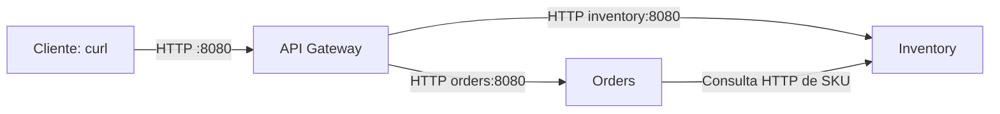

# P00 — Primer contacto con Advanced Orders Platform
**CORE.** La primera descarga y construcción puede añadir espera. Borrador editorial para ensayo; resultados indicados como esperados, no observaciones de tu Codespace.

## 1. Contexto y misión
Advanced Orders Platform es una plataforma didáctica de comercio electrónico. Un cliente quiere saber si puede adquirir un producto antes de confirmar el pedido. Orders recibe la consulta e Inventory conoce las existencias. El API Gateway proporciona una entrada común. No estamos todavía creando pedidos ni reservando stock: consultamos disponibilidad. El catálogo es simulado, sin datos de clientes ni pagos reales.

Tu misión es convertirte en miembro del equipo de desarrollo: disponer de un entorno reproducible, comprobar el estado inicial de la plataforma y poder explicar la ruta de una petición antes de introducir nuevas funcionalidades.

### Objetivos de aprendizaje
Al terminar, podrás identificar qué servicio posee cada responsabilidad, distinguir el puerto del contenedor del puerto del entorno, ejecutar las pruebas de regresión, comprobar el estado funcional y explicar cómo Orders consulta Inventory. No necesitas experiencia previa con Parte 2, credenciales de Azure ni instalaciones locales.

## 2. Arquitectura inicial

La plataforma contiene seis módulos Maven, pero solo arrancan tres por defecto. Shipping, Payments y Notifications se activan en prácticas posteriores. Cada proceso tiene su propia red/puerto en Docker; el host de Codespaces publica 8080 (Gateway), 8081 (Inventory), 8082 (Orders), todos vinculados a loopback. No hagas públicos los puertos de Codespaces. Las llamadas entre contenedores utilizan nombres DNS de Compose y el puerto interno 8080.

| Archivo | Qué encontrarás |
|---|---|
| `.devcontainer/devcontainer.json` | Entorno Java 21, Maven y Docker en Codespaces |
| `pom.xml` | Proyecto Maven padre y seis módulos |
| `docker-compose.yml` | Servicios, red, puertos, healthchecks y perfil extended |
| `Makefile` | Tareas repetibles de construcción y comprobación |
| `scripts/preflight.sh` | Comprobación de herramientas |
| `scripts/verify-baseline.sh` | Comprobación de salud y negocio |
| `services/orders/src/main/java/com/advancedorders/orders/api/OrderPreviewController.java` | Contrato HTTP de la consulta |
| `services/orders/src/main/java/com/advancedorders/orders/service/OrderPreviewService.java` | Decisión de disponibilidad |
| `services/orders/src/main/java/com/advancedorders/orders/client/InventoryClient.java` | Comunicación HTTP con Inventory |

## 3. Comprueba el entorno
Abre el Codespace del checkpoint P00/P01 indicado por el instructor, desde navegador. No utilices una rama de soluciones. Abre terminal en la raíz del repo.
```bash
git status --short --branch
git rev-parse --short HEAD
make preflight
```
El primer comando muestra la rama y cambios locales; el segundo identifica el checkpoint. Preflight comprueba Java, Maven, Docker, Compose, curl, Python y make. Esperado: Java 21, Maven 3.9.11 según configuración y mensaje `Preflight OK: entorno local; no se utiliza Azure.` Si hay un error, guarda la primera línea relevante y consulta SUPPORT; no instales nada en tu ordenador.

## 4. Construye y arranca
```bash
make test
make up
docker compose ps
```
`make test` ejecuta Maven y pruebas de regresión existentes; no incluye las pruebas de ejercicio P01 que fallan hasta implementar. Debe finalizar con BUILD SUCCESS. `make up` construye las imágenes y arranca Gateway, Orders e Inventory, esperando sus healthchecks. En la primera ejecución puede descargar dependencias e imágenes. Mientras tanto, localiza el POM raíz y los POM de Orders e Inventory. No confundir compilación y arranque.

Esperado en `docker compose ps`: tres servicios en ejecución y saludables. Si falta alguno, ejecuta `make logs` y conserva el error. No borres imágenes o volúmenes globalmente.

## 5. Sigue una petición
```bash
make verify
curl -fsS 'http://127.0.0.1:8080/api/orders/preview?sku=SKU-001&quantity=2'
curl -fsS 'http://127.0.0.1:8081/api/inventory/SKU-001'
```
El verificador consulta salud de los tres servicios, la consulta de Orders y el contrato de Inventory. Espera `Baseline OK`. La primera petición muestra, entre otros campos, `sku`, `quantity`, `canBeFulfilled`, `inventoryAvailable`, `servedBy`, `inventoryServedBy` y `serviceVersion`. Para SKU-001, hay 42 unidades y la cantidad 2 es atendible. Los nombres de instancia pueden variar.

Abre OrderPreviewController y localiza GET /preview. Sigue el método preview hasta OrderPreviewService, y de ahí a InventoryClient.getInventory. No necesitas modificar Java en P00. Predice qué cambiará si solicitas 43 unidades y compruébalo:
```bash
curl -fsS 'http://127.0.0.1:8080/api/orders/preview?sku=SKU-001&quantity=43'
```
Esperado: HTTP 200, canBeFulfilled=false. Eso no es una avería: es una decisión de negocio. ¿Por qué no disminuye inventoryAvailable después de consultar?

## 6. Cierre
Conserva rama/SHA, salida de make verify y un diagrama sencillo de la petición. Explica quién conoce stock, quién decide disponibilidad y por qué un healthcheck UP no demuestra por sí solo que el negocio funciona. El instructor confirmará que puedes avanzar. Deja los servicios arrancados para P01; si interrumpes la sesión, `make down` los detiene.

**Siguiente:** [P01 — Diseñar e implementar una estimación de pedido](../p01-architecture/README.md). Allí sí desarrollarás Java para incorporar Shipping.

[SUPPORT — recuperación](SUPPORT.md) · [Evidencias](EVIDENCE.md)
