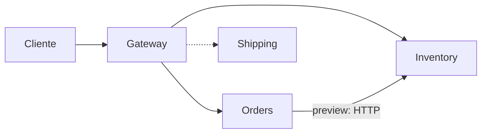
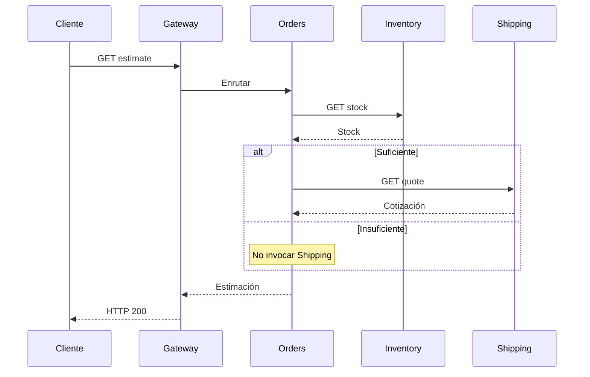

# P01 — Diseñar e implementar una estimación de pedido
**O1 · CORE.** Prerrequisito: P00. Borrador editorial para ensayo. No necesitas Azure ni Parte 2.

## 1. Historia de negocio y arquitectura
El equipo de comercio de Advanced Orders Platform quiere mostrar al cliente, antes de confirmar una compra, si hay stock suficiente y cuánto costará el envío. Hoy solo dispone de `GET /api/orders/preview`: Orders consulta Inventory y responde si la cantidad es atendible. El servicio Shipping ya calcula precios de transporte, pero Orders todavía no lo utiliza.

El equipo de producto pide una nueva funcionalidad de **estimación**, no un pedido real. No debe reservar inventario, cobrar, enviar notificaciones ni modificar datos. El precio de envío es simulado y lo decide Shipping, no Orders. No queremos duplicar sus reglas ni compartir su código de negocio.


**Tu misión:** modelar una composición síncrona de servicios y construirla en Java. Orders será dueño de la composición de la estimación; Inventory del stock; Shipping de la cotización; Gateway del enrutamiento.

### Contrato solicitado
`GET /api/orders/estimate?sku=SKU-001&quantity=2&destination=ES&weightGrams=500`

| Campo de entrada | Restricción |
|---|---|
| sku | No vacío |
| quantity | Entero positivo |
| destination | Dos letras mayúsculas |
| weightGrams | Entero entre 1 y 10000 |

`weightGrams` es el peso total del envío indicado por el cliente, no el peso unitario; no multiplicarlo por quantity. Para este ejercicio, el contrato fija estas respuestas:

| Caso | Resultado |
|---|---|
| Stock suficiente | 200, canBeFulfilled=true, inventoryAvailable y shipping con cotización |
| Stock insuficiente | 200, canBeFulfilled=false, shipping=null; no llamar a Shipping |
| Entrada inválida | 400; no iniciar llamadas remotas |
| Inventory indisponible | 502 INVENTORY_UNAVAILABLE; no llamar a Shipping |
| Shipping indisponible con stock suficiente | 502 SHIPPING_UNAVAILABLE; no inventar precio |

En nuestro simulador SKU-001 tiene 42 unidades. Para ES/500 g, Shipping devuelve 499 céntimos EUR, plazo 3 días y proveedor SIMULATED. No codifiques estos valores en Orders: proceden de la respuesta del servicio.

Diseña el diagrama de secuencia, identifica quién valida cada dato y compara con un monolito modular: una llamada local podría ser una invocación de método; aquí aparecen latencia y fallos de red. Dibuja qué ocurre si no hay stock y si Shipping falla. Usa este diagrama como referencia del flujo objetivo, no como implementación:


## 2. Comprueba el starter
```bash
make p01-up
make verify
curl -fsS 'http://127.0.0.1:8080/api/shipping/quote?destination=ES&weightGrams=500'
make p01-test
```
Ahora hay cuatro servicios: se añade Shipping. El último comando ejecuta pruebas de aceptación del ejercicio; deben fallar por los TODOs (UnsupportedOperationException). Si falla la compilación, el arranque o make verify, resuelve primero ese problema: no es el fallo esperado.

### Mapa de archivos
En `services/orders/src/main/java/com/advancedorders/orders/`:
- `api/OrderPreviewController.java`, `service/OrderPreviewService.java`, `client/InventoryClient.java`: ejemplo de funcionalidad existente, lee y compara.
- `client/ShippingQuote.java`: DTO de respuesta remota (preparado).
- `client/ShippingClient.java`: constructor y cliente configurados; completa quote.
- `api/OrderEstimateResponse.java`: contrato de salida (preparado).
- `service/OrderEstimateService.java`: completa estimate.
- `api/OrderEstimateController.java`: completa endpoint.
- `client/ShippingUnavailableException.java` y `api/ApiExceptionHandler.java`: traducción de error preparada.

Las pruebas están en `services/orders/src/test/java/com/advancedorders/orders/service/OrderEstimateExercise.java`. Gateway: `services/api-gateway/src/main/resources/application.yml`.

## 3. Implementación guiada
### 3.1 Cliente HTTP
Abre ShippingClient y revisa cómo recibe RestClient.Builder y una URL de configuración. Completa quote(destination, weightGrams). Debe invocar GET /api/shipping/quote con los dos parámetros, deserializar ShippingQuote y rechazar un cuerpo vacío. Traduce RestClientException a ShippingUnavailableException. No devuelvas null ni valores inventados ante fallo. Usa el InventoryClient existente como ejemplo, y SUPPORT si necesitas una pista. ¿Por qué la URL base no debe quedar fijada a localhost?

### 3.2 Servicio de negocio
Completa estimate. Orden de trabajo: valida los cuatro datos antes de llamar a otros servicios, consulta Inventory, compara available con quantity, construye respuesta negativa sin Shipping o consulta Shipping y compone respuesta positiva. No dupliques reglas de precio ni añadas persistencia.
Ejecuta `make p01-test`. Los cuatro escenarios comprueban resultado positivo, stock insuficiente sin interacción con Shipping, entradas inválidas sin llamadas y propagación de fallo Shipping. Lee el primer fallo y corrige código; no alteres aserciones para que pasen.

### 3.3 Controlador y prueba propia
Expón GET /estimate dentro de OrderEstimateController y enlaza los cuatro query params. Delega en service. No pongas lógica de comunicación en el controlador. Añade al test un caso de fallo de Inventory: prepara el mock para lanzar InventoryUnavailableException, comprueba que se propaga y que Shipping no recibe llamadas. Ejecuta `make p01-test` otra vez. La prueba unitaria no comprueba la red ni el endpoint; lo haremos después.

## 4. Gateway, aceptación y fallo parcial
Añade una ruta de Gateway `/stock/{sku}` que reenvíe a Inventory `/api/inventory/{sku}`. Usa Path y SetPath (o RewritePath equivalente); conserva rutas previas. No cambies la ruta de estimate: /api/orders/** ya llega a Orders.
```bash
docker compose --profile extended up -d --build --wait orders api-gateway
make p01-verify
```
El verificador prueba HTTP positivo, negativo, validación, ruta nueva y regresión de preview. Espera `P01 acceptance passed`. Comprueba manualmente dos respuestas antes de probar fallo:
```bash
BASE=http://127.0.0.1:8080
URL="$BASE/api/orders/estimate"
curl -fsS "$URL?sku=SKU-001&quantity=2&destination=ES&weightGrams=500"
curl -fsS "$URL?sku=SKU-001&quantity=43&destination=ES&weightGrams=500"
docker compose --profile extended stop shipping
curl -i --max-time 15 "$URL?sku=SKU-001&quantity=2&destination=ES&weightGrams=500"
curl -i --max-time 15 "$URL?sku=SKU-001&quantity=43&destination=ES&weightGrams=500"
make p01-up
```
Esperado: con stock suficiente, 502 SHIPPING_UNAVAILABLE; sin stock, 200 y shipping null. Si curl expira, registra la incidencia y revisa logs: no confundas un timeout de curl con respuesta HTTP de la aplicación. Restaura Shipping y comprueba la primera consulta otra vez.

## 5. Experimento de latencia
Mide tres consultas a preview y tres a estimate, con el mismo SKU/cantidad. El tiempo incluye la llamada desde curl a Gateway y las dependencias; no es medición de CPU.
```bash
PREVIEW="$BASE/api/orders/preview?sku=SKU-001&quantity=2"
ESTIMATE="$URL?sku=SKU-001&quantity=2&destination=ES&weightGrams=500"
for i in 1 2 3; do
  curl -sS -o /dev/null -w 'preview %{http_code} %{time_total}s\n' "$PREVIEW"
  curl -sS -o /dev/null -w 'estimate %{http_code} %{time_total}s\n' "$ESTIMATE"
done
TRAINING_INVENTORY_DELAY_MS=1000 docker compose up -d --force-recreate --wait --no-deps inventory
```
Repite el bucle y restaura Inventory:
```bash
docker compose up -d --force-recreate --wait --no-deps inventory
make p01-verify
```
¿Por qué se añade latencia a ambas rutas? ¿Qué cambia al introducir Shipping? No afirmes una diferencia exacta sin medir. Propón una alternativa si el negocio admite estimación parcial y explica sus riesgos. P02 tratará los fallos mediante políticas explícitas, no improvises Retry ahora.

## 6. Entrega y transición
Entrega diagrama inicial/final, contrato, diff Java/YAML, prueba propia, resultados de aceptación y tabla de latencias. Justifica por qué la lógica está en Orders y no Gateway. Guarda tu trabajo en commit propio. Si no completaste el ejercicio, conserva tu rama y utiliza el checkpoint P02 cuando el instructor lo indique; no reemplaces a fuerza tu trabajo. 
**Siguiente:** P02, resiliencia ante latencia y fallos de Inventory.

[SUPPORT — pistas](SUPPORT.md) · [STRETCH](STRETCH.md) · [Evidencias](EVIDENCE.md)
